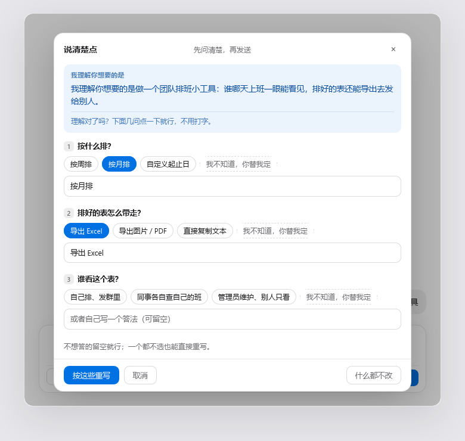
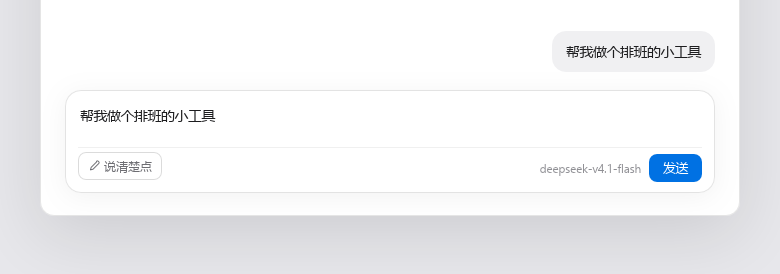
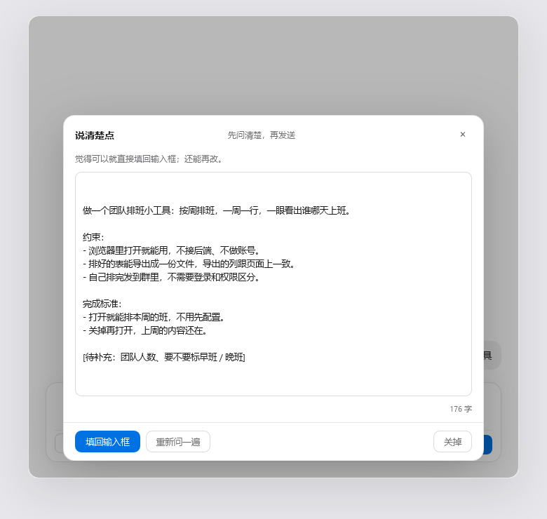

# dsh-ask-first

<p align="center"></p>

A clarification button for the DeepSeek Harness composer — it asks what you meant before it rewrites anything.

[中文说明](README.zh.md) · [Source](https://github.com/BAIYE0303/dsh-ask-first)

Most prompt-rewriting plugins assume you can already say what you want, and only tidy up the wording.
This one assumes the opposite: the draft is vague because **the person could not say it yet**. So it
restates what it understood, asks two or three questions that can be answered by clicking, and only
then rewrites — into a request an agent can start on without asking again.

---



It says what it thinks you meant, asks what would actually change the answer, and hands back a request
with a goal, the constraints, and a definition of done.

## Install

```bash
dsh plugin --profile web add dsh-ask-first
```

Or in the GUI: **Plugins → Add plugin**, and paste `dsh-ask-first`.

The plugin has a browser half, so **restart the host** after installing. The button then sits at the
bottom-left of the composer, on the send row. There is nothing to configure and no key to paste.

## Try it on one vague draft

### 1. Type three words, then click 说清楚点

Put something short in the composer — even "make me a page" — and click **说清楚点** (Say it clearer)
before sending. The button's tooltip reads *不用会描述：点几下选项，我替你把需求问清楚*.



The panel opens with the title **说清楚点** and the line **先问清楚，再发送**. Your draft is untouched,
and nothing has been sent.

### 2. Read the restatement, then answer by clicking

The first block in the panel is one sentence under the label **我理解你想要的是** — the model's own
words for what it took from your draft. That sentence is the only thing that tells you whether it
understood you, which is why it gets its own block instead of being folded into the result.

Below it: **理解对了吗？下面几问点一下就行，不用打字。** Two or three questions follow, picked because
their answers would change the result. Every question comes with clickable options, and every question
ends with **我不知道，你替我定** — so a user who cannot answer still has a way to answer.

Typing is optional throughout. Each question also takes a free-text line, labelled
**或者自己写一个答法（可留空）**, and the panel says so: **不想答的留空就行；一个都不选也能直接重写。**

### 3. Take the rewrite back into the composer

Click **按这些重写** and you get **正在按你的选择重写……**, then the result under
**觉得可以就直接填回输入框；还能再改。**, with a character count.



The rewrite is one request an agent can start on: goal first, then the constraints, then what counts as
done. Anything the model does not actually know stays as a visible `[待补充：…]` placeholder instead of
being invented. Three buttons: **填回输入框**, **重新问一遍**, **关掉**.

**It never sends.** Writing the draft back is the last thing it does; the send key stays yours.

## What distinguishes it from other prompt rewriters

- **It restates before it asks** — the panel opens with *"what I understand you want is …"* in its own block, so a wrong reading is visible before you spend a rewrite on it.
- **Questions you can answer without typing** — options are generated from that specific draft, not pulled from a fixed questionnaire, and the last option of every question is **我不知道，你替我定**.
- **The zero-typing path is enforced in code** — if the model returns no options, or forgets the escape option, the host half adds them before the panel renders. It is not left to the prompt.
- **It will not invent parameters** — anything genuinely unknown stays as `[待补充：…]`, to fill in or delete.
- **It never sends** — the result goes back into the composer through `inputActions.setDraft()` and stops there.
- **Your current model, no setup** — no API key, no provider config, no settings page.
- **A bad model reply is not a failure** — if the answer is not parseable JSON, the raw text becomes the restatement and the panel goes straight to rewriting.

## When not to use it

- **You already write clear requests.** Then every click costs you two model calls to learn nothing.
- **You want the agent to just start.** This button's whole job is to ask first — the opposite of "stop asking me, go".
- **You want different wording for the same request.** Tone, translation and shortening are rewrite jobs; this one changes what the request *is*.
- **No LLM service is wired up in your host.** The panel says it cannot reach the local rewriter rather than producing a fake result.

## How it works

Two halves, one package.

| Path | Role |
| --- | --- |
| `lib/index.js` | Host half. Registers three loopback-only `POST` routes and makes every model call (`ctx.llm.stream`). |
| `lib/client.js` | Browser half. Registers the button and the panel in the `conversation.input.left` slot, and writes the result back with `inputActions.setDraft()`. |
| `cordis.patch.yml` | Lets the host insert this package into the plugin tree. |
| `test-offline.mjs` | Offline self-check. No network, no host: `node test-offline.mjs`. |

### Routes

| Method | Path | Body | Response |
| --- | --- | --- | --- |
| POST | `/api/dsh-ask-first/health` | `{}` | `{ ok, value: { llm, provider?, model? } }` |
| POST | `/api/dsh-ask-first/ask` | `{ draft }` | `{ ok, value: { guess, questions: [{ id, question, hint, options[] }] } }` |
| POST | `/api/dsh-ask-first/rewrite` | `{ draft, answers: [{ question, answer }] }` | `{ ok, value: { text } }` |

All three accept loopback requests only: the socket address must be `127.0.0.1`, `::1` or
`::ffff:127.0.0.1`, the `Host` header must be loopback, and a request whose `Origin` points at another
host — or which carries `sec-fetch-site: cross-site` — is refused with `403`.

### Which model it uses

No API key, no provider config, no settings page. The plugin calls `ctx.llm.stream` with the provider and
model that `agentDefaultModel.currentSelection()` reports — the same one shown in the corner of the
composer. If that service is unavailable it omits both and lets the host fall back to the last target
used.

The honest cost: one click is **two model calls** — one to ask, one to rewrite — billed to whatever your
current session is billed to.

### When the model misbehaves

The model is asked for strict JSON and does not always comply. If the reply cannot be parsed, that is not
an error: the raw text becomes the "what I understand you want" sentence and the panel goes straight to
rewriting. Questions are capped at three, options at four, and long fields are truncated, so a runaway
reply cannot wreck the panel.

---

The rest of this file is for people checking the package, not for people deciding whether to install it.

## Self-check

```bash
node test-offline.mjs
```

39 checks, no network and no host process: route registration, request validation, JSON extraction from
fenced replies, option normalisation, cross-site rejection, and the request body sent to the model.

## Notes for reviewers

- `lib/client.js` is a single `window.__ModuleLoader__.load({ id, factory })` wrapper. That is the standard shape for a DeepSeek Harness client plugin, not a bundler artefact: the module body is plain readable source, unminified, and the only `require` calls are `react` and `react-dom`, which the host provides.
- No credentials, no telemetry, no outbound requests. The only network calls are the loopback routes above, and the only model calls go through the host's own `ctx.llm` service.
- No install-time scripts.
- `preview/shot.html` is the page the README screenshots were taken from. It loads the real `lib/client.js` against a stub host and a stub backend, so the shots show the actual panel. It is not part of the published package (see `files` in `package.json`), and it needs a React UMD build in `preview/vendor/` to run — that directory is git-ignored, fetch it from jsDelivr if you want to regenerate shots.

## License

[MIT](LICENSE)
