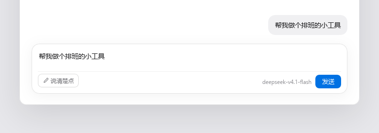
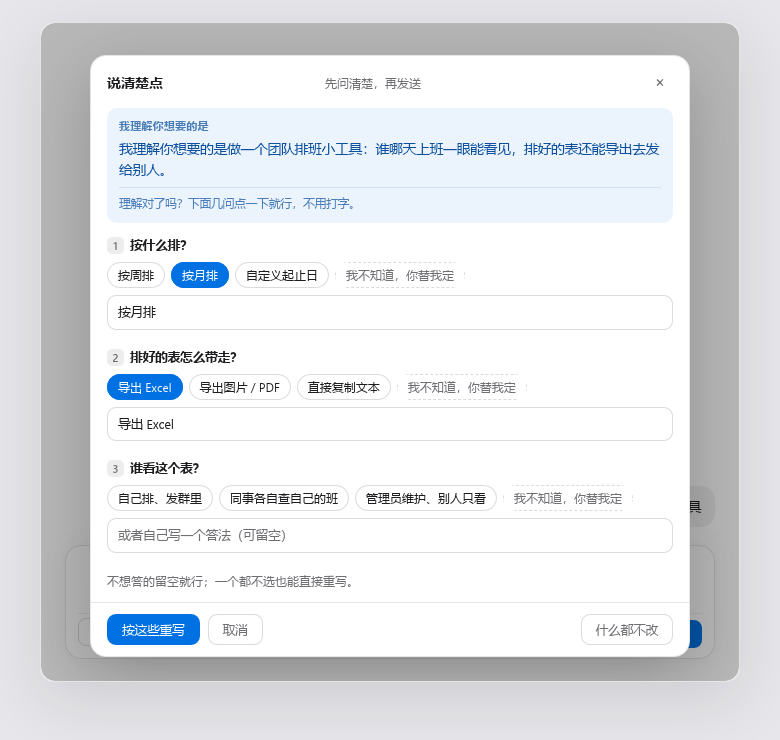
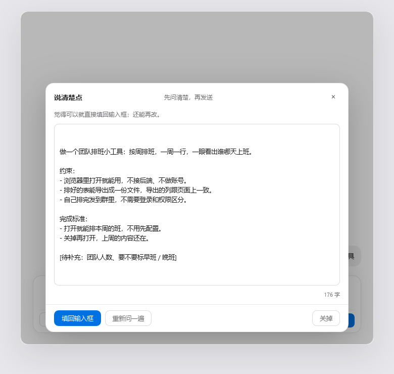

# dsh-ask-first · 说清楚点

[English](README.md)

> DeepSeek Harness 输入框里的一个按钮：**先问，再写**。
> 你不用会描述——点几下选项，话由它替你说清楚。

大多数「优化提示词」的插件都假设你已经能把自己的想法讲明白，它们只负责把措辞修整齐。
这个插件的假设正好相反：草稿之所以含糊，是因为**人还没想清楚、或者不会说**。所以它先问两三个
带可点选项的问题，问完再重写。

## 它做什么

在输入框里随便写一句，哪怕只是「帮我做个页面」，然后点输入框左下角的 **说清楚点**（发送之前）。

1. 模型先用自己的话复述一遍它听懂了什么：「我理解你想要的是……」。这句话是判断它有没有听懂
   的唯一依据，所以单独成块显示。
2. 它问两三个真会改变结果的问题。**每个问题都带可点选项**，并且每个问题的最后一项固定是
   「我不知道，你替我定」——答不上来的人也有路可走，每一步都可以不打字。
3. 它把你的原话加上你的选择，重写成一条**能直接开工的需求**：先说清目标，再列关键约束，最后
   写什么算完成。确实不知道的信息不会瞎编，会留成看得见的 `[待补充：…]` 占位。
4. 你读一遍，想改就改，点一下填回输入框。**它从不替你发送**，发送键仍然在你手上。

如果它觉得你这句话已经够清楚了，会直接告诉你，并给出重写结果。

## 截图



一句短话，一个按钮。你不点发送，它什么都不发。



它先复述听懂了什么，再问。每道题都能点着答，且最后一项固定是「我不知道，你替我定」——
所以整块面板走完可以一个字都不打。每道题下面的输入框是可选的。



结果是能直接开工的一条需求：目标、约束、什么算完成。它真不知道的东西会标成 `[待补充：…]`
而不是编一个。填回输入框后你还能接着改。

## 为什么一定要有可点选项

一个问题只对「答得上来的人」有用。「你想要什么风格」这种问法，对「不会表达」的人完全无效——
他只会再打一句含糊的话，或者干脆放弃。固定选项把开放题变成选择题，认起来容易得多；
而「我不知道，你替我定」这一项，把「被迫打字」的最后一种情况也消掉了。

## 安装

```bash
dsh plugin --profile desktop add dsh-ask-first
```

或者打开 GUI：**插件 → 添加插件**，填包名。

插件带浏览器半边，装完**需要重启宿主**。按钮出现在输入框左下角、发送那一行的左侧。

## 工作原理

两半，一个包。

| 文件 | 作用 |
| --- | --- |
| `lib/index.js` | Host 半边。注册三条只接受 loopback 的 `POST` 路由，所有模型调用都在这里（`ctx.llm.stream`）。 |
| `lib/client.js` | 浏览器半边。在 `conversation.input.left` 插槽注册按钮与面板，用 `inputActions.setDraft()` 回填输入框。 |
| `cordis.patch.yml` | 让宿主把这个包插进插件树。 |
| `test-offline.mjs` | 离线自检。不联网、不启宿主：`node test-offline.mjs`。 |

### 接口

| 方法 | 路径 | 请求体 | 响应 |
| --- | --- | --- | --- |
| POST | `/api/dsh-ask-first/health` | `{}` | `{ ok, value: { llm, provider?, model? } }` |
| POST | `/api/dsh-ask-first/ask` | `{ draft }` | `{ ok, value: { guess, questions: [{ id, question, hint, options[] }] } }` |
| POST | `/api/dsh-ask-first/rewrite` | `{ draft, answers: [{ question, answer }] }` | `{ ok, value: { text } }` |

三条都只接受本机请求：socket 地址必须是 `127.0.0.1`、`::1` 或 `::ffff:127.0.0.1`，`Host` 头必须是
loopback，`Origin` 指向别的宿主、或者带 `sec-fetch-site: cross-site` 的请求一律 `403`。

### 用哪个模型

不需要填 API key，不需要配 provider，没有设置页。插件调 `ctx.llm.stream` 时用的是
`agentDefaultModel.currentSelection()` 报的 provider / model——就是输入框右下角显示的那一个。
拿不到这个服务就整对省略，让宿主自己回退到最后一次用过的目标。所以它花的就是你当前会话的钱，
没有新东西要填。

### 退化行为

向模型要的是严格 JSON，而模型不总听话。解析不出 JSON 不算错误：原文直接当作「我理解你想要的是」
那句话，面板跳到重写步骤。如果模型没给选项、或者忘了「我不知道，你替我定」这一项，Host 半边会
补上——零打字这条路是用代码保证的，不指望提示词。

## 自检

```bash
node test-offline.mjs
```

39 项，不联网、不起宿主：路由注册、请求校验、从围栏里抠 JSON、选项清洗、跨站拒绝，以及发给模型
的请求体内容。

## 给评审的说明

- `lib/client.js` 是一个 `window.__ModuleLoader__.load({ id, factory })` 包裹。这是 DeepSeek Harness
  客户端插件的标准形态，不是打包产物：模块体是可读明文源码、没有压缩，唯一的 `require` 是
  `react` 与 `react-dom`，两个都由宿主提供。
- 没有凭据、没有埋点、没有对外请求。唯一的网络调用就是上面那三条 loopback 路由，唯一的模型调用走
  宿主自己的 `ctx.llm` 服务。
- 没有安装期脚本。
- `preview/shot.html` 是 README 截图所用的页面。它把真实的 `lib/client.js` 加载进来，外面配一个
  假宿主和假后端，所以截出来的就是真面板。它不在发布包里（见 `package.json` 的 `files`）；要重跑
  截图需要 `preview/vendor/` 下有 React 的 UMD 构建，那个目录被 gitignore 了，从 jsDelivr 取即可。

## 许可

MIT
