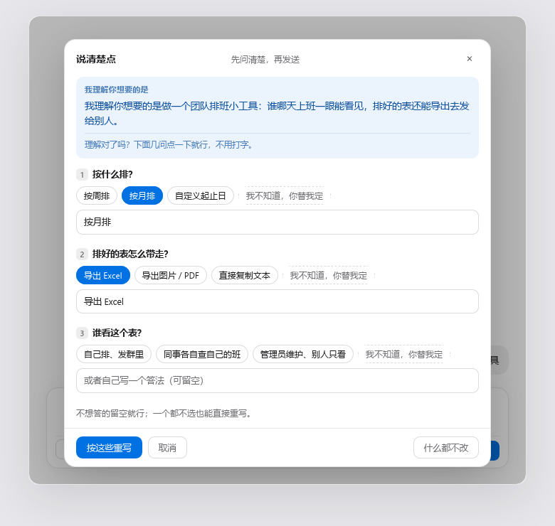

<!--
Listing version for the awesome-dsh-plugin detail page. That site renders the repository README as-is, but
drops bare HTML, strips the first H1, and demotes every heading by one level — hence the paragraph opening,
no HTML, and a Markdown image first.

To switch to it: copy this over the repository root README.md (and change ../assets/ to assets/).
Normally you do not need to — GitHub keeps using the root README.md.
-->

A clarification button for the DeepSeek Harness composer — it asks what you meant before it rewrites
anything. When a draft is vague it does not ask you to say it again; it restates what it understood,
then asks two or three questions you can answer by clicking.



## What it does

1. Type anything, even "make me a page".
2. Click **说清楚点** (Say it clearer) at the bottom-left of the composer. The panel opens with one
   sentence under **我理解你想要的是** — the model's own words for what it took from your draft, so a
   wrong reading is visible before you spend a rewrite on it. Two or three questions follow, picked
   because their answers would change the result. Every question has clickable options, and every
   question ends with **我不知道，你替我定** — a user who cannot answer still has a way to answer.
3. Click **按这些重写** and get back one request with a goal, the constraints, and a definition of
   done. **It never sends.** Writing the draft back is the last thing it does.

Typing is optional throughout: each question also takes a free-text line, and the panel says so.

## Install

```bash
dsh plugin --profile web add dsh-ask-first
```

**Restart the host** afterwards — the plugin has a browser half. The button then sits at the
bottom-left of the composer, on the send row. Nothing to configure and no key to paste: it uses the
model your session is already using.

## What distinguishes it from other prompt rewriters

- **It restates before it asks** — that sentence gets its own block, so a wrong reading shows up before the rewrite, not after it.
- **Questions you can answer without typing** — options are generated from that specific draft, not pulled from a fixed questionnaire, and the last option of every question is the escape option.
- **The zero-typing path is enforced in code** — if the model returns no options, or forgets the escape option, the host half adds them before the panel renders. It is not left to the prompt.
- **It will not invent parameters** — anything genuinely unknown stays as a visible `[待补充：…]` placeholder.
- **It never sends** — the result goes back into the composer through `inputActions.setDraft()` and stops there.
- **Your current model, no setup** — no API key, no provider config, no settings page.
- **A bad model reply is not a failure** — if the answer is not parseable JSON, the raw text becomes the restatement and the panel goes straight to rewriting.

## When not to use it

- **You already write clear requests.** Then every click costs you two model calls to learn nothing.
- **You want the agent to just start.** This button's whole job is to ask first — the opposite of "stop asking me, go".
- **You want different wording for the same request.** Tone, translation and shortening are rewrite jobs; this one changes what the request *is*.
- **No LLM service is wired up in your host.** The panel says it cannot reach the local rewriter rather than producing a fake result.

## What it does not do

- It does not press send — the draft goes back into the composer and waits for you.
- It does not send your text anywhere else — the three routes accept loopback requests only, and every model call goes through the host's own `ctx.llm` service.
- It runs no install-time scripts, reads no credentials and does no telemetry.

## How it works

Two halves, one package. `lib/index.js` is the host half: three loopback-only `POST` routes and every
model call. `lib/client.js` is the browser half: the button and the panel in the
`conversation.input.left` slot, writing back with `inputActions.setDraft()`. No outbound requests.

## License

MIT
