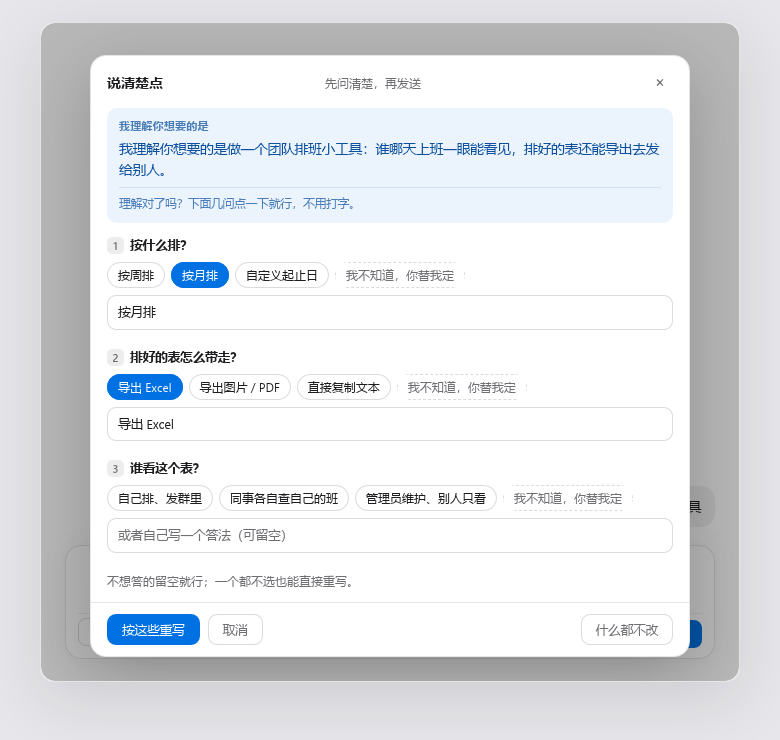

<!--
官网版正文（awesome-dsh-plugin 详情页）。该站把仓库 README 原样渲染，但会丢弃裸 HTML、剥掉首行 H1、
所有标题降一级，所以这一份从段落起笔、不含 HTML、首图用 Markdown 图片语法。

要切到官网版：把它覆盖到仓库根 README.zh.md（并把下面的 ../assets/ 改成 assets/）。
平时不用动它——GitHub 首页用根目录的 README.zh.md。
-->

DeepSeek Harness 输入框里的一个澄清按钮：先问你什么意思，再动笔改写。草稿含糊的时候它不催你重说一遍，
而是先复述它听懂的内容，再问两三个点一下就能答的问题。



## 它做什么

1. 你先随便写一句，哪怕只是「帮我做个页面」。
2. 点输入框左下角的 **说清楚点**。面板第一块是 **我理解你想要的是** 一句话复述——理解错了，在花掉
   一次重写之前就能看见。下面两三个问题，都是「答案会改变结果」的那几点；**每个问题都带可点选项**，
   最后一项固定是 **我不知道，你替我定**，答不上来的人也有路可走。
3. 点 **按这些重写**，拿回一条带目标、约束和完成标准的需求。**它不替你发送**，只把结果填回输入框。

全程打字都是可选的：每道题下面还有一行自由输入，留空也能走完。

## 安装

```bash
dsh plugin --profile web add github:BAIYE0303/dsh-ask-first
```

装完**需要重启宿主**，因为插件带浏览器半边。按钮随后出现在输入框左下角、发送那一行。没有配置项，
也没有 key 要填——它用你当前会话正在用的那个模型。

## 它和其它提示词改写插件差在哪

- **先复述，再追问**——把「我理解你想要的是……」单独成块，理解错了当场可见，不是在结果里才发现。
- **问题可以不打字就答完**——选项按这一句草稿现生成，不是固定问卷；每问最后一项固定是那个逃生项。
- **零打字这条路由代码兜底**——模型没给选项、或者忘了逃生项，Host 半边在面板渲染前补上，不指望提示词自觉。
- **不编参数**——确实不知道的留成看得见的 `[待补充：…]`，由你补或删。
- **从不替你发送**——结果用 `inputActions.setDraft()` 写回输入框就停下。
- **用你当前的模型，零配置**——不要 API key，不配 provider，没有设置页。
- **模型不听话不算故障**——解析不出 JSON 时，原文直接当作复述，面板跳过追问直接重写。

## 什么时候别用它

- **你本来就会把话说清楚。** 那每一次点击都是白花两次模型调用。
- **你希望 agent 立刻开工。** 这个按钮的全部工作就是「先问」，和「别问了赶紧干」正好相反。
- **你只是想要另一种说法。** 换语气、翻译、缩短是改写活儿；这个插件改的是「需求本身是什么」。
- **你的宿主没接 LLM 服务。** 面板会直接说连不上本机改写服务，而不是编一个结果给你。

## 它不会做什么

- 不会替你按发送键——改完就停，草稿回到输入框里等你。
- 不会把你的话发到外面——三条接口只接受本机 loopback 请求，模型调用走宿主自己的 `ctx.llm` 服务。
- 不会安装期跑脚本，也不读凭据、不做埋点。

## 工作原理

两半，一个包。`lib/index.js` 是 Host 半边，注册三条只接受 loopback 的 `POST` 路由并负责全部模型调用；
`lib/client.js` 是浏览器半边，在 `conversation.input.left` 插槽挂按钮和面板，用 `inputActions.setDraft()`
回填。没有网络出口。

## 许可

MIT
